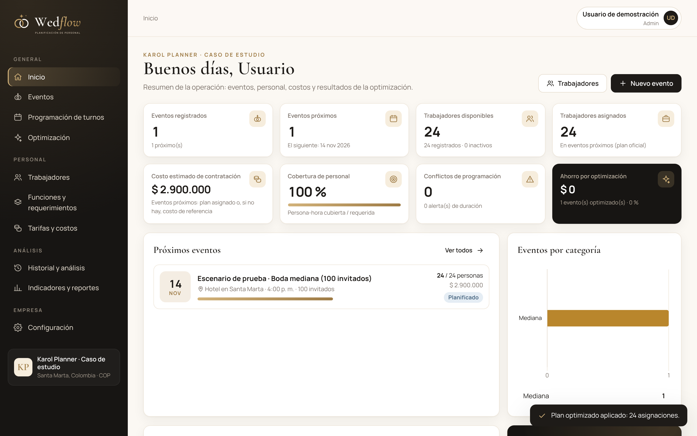
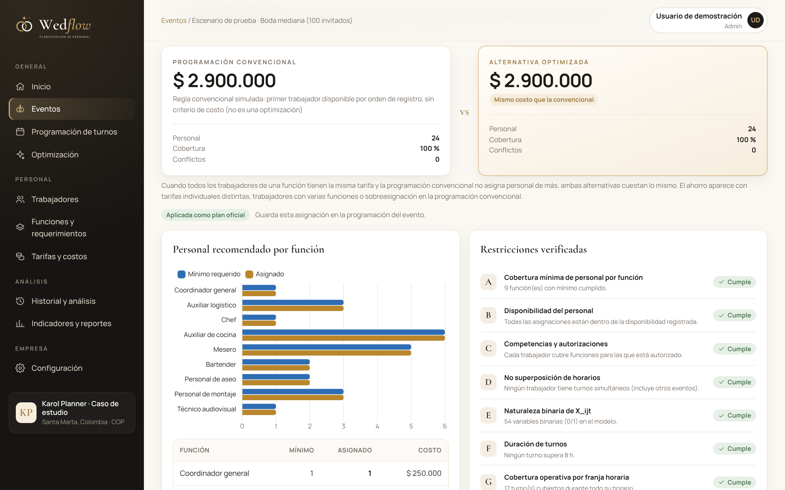
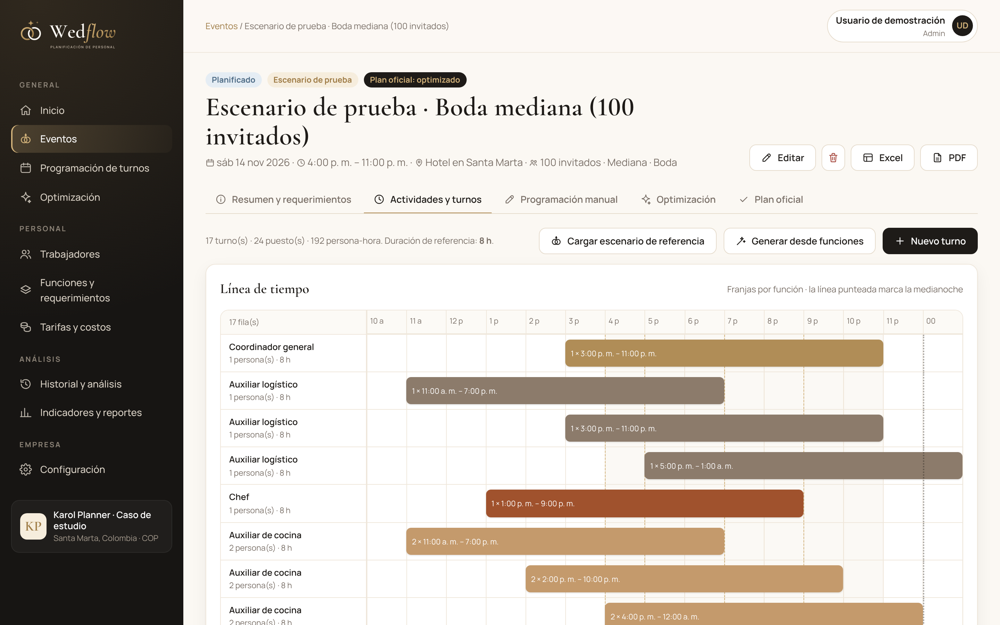
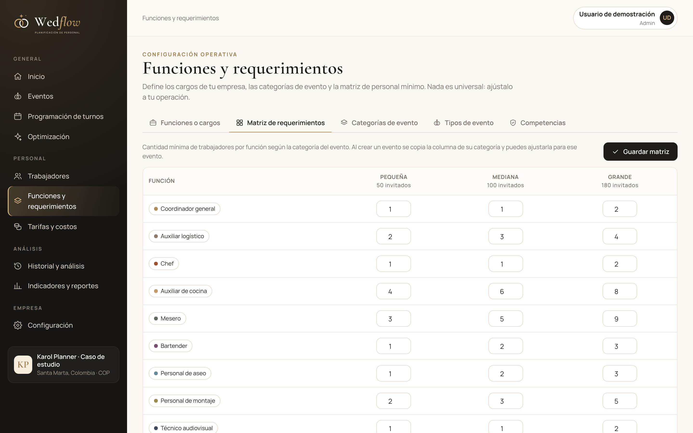
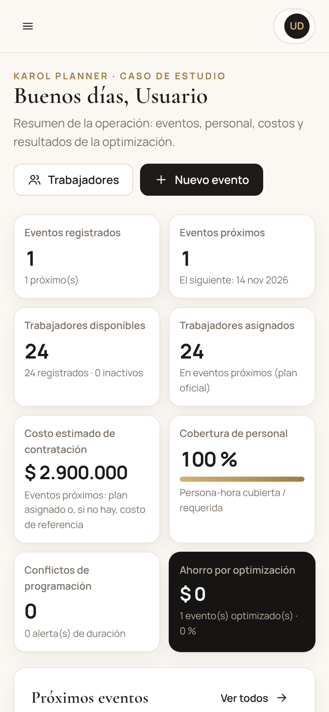

# Wedflow

Plataforma web para planificar, programar y optimizar el personal de empresas organizadoras de bodas (Wedding Planners).

Cualquier Wedding Planner puede:

- registrarse y configurar su empresa;
- cargar sus trabajadores, funciones, tarifas y requerimientos mínimos;
- crear eventos con sus turnos;
- obtener la asignación de personal de **menor costo** que cumple todas las restricciones operativas. La asignación se calcula con un modelo de programación lineal entera (MILP) resuelto con [HiGHS](https://highs.dev).

Para las pruebas iniciales trae una configuración de demostración basada en el caso de estudio **Karol Planner** (Santa Marta, Colombia). Es una referencia editable, no un valor obligatorio.



## Puesta en marcha

Requiere Node.js 22.13 o superior (usa `node:sqlite`, incluido en Node).

```bash
cd wedflow
npm install
npm start
```

Abre <http://localhost:3000>. En el primer arranque se crea la cuenta de demostración `demo@wedflow.app` / `Wedflow2026`, que trae el caso Karol Planner cargado. Para no crearla, usa `WEDFLOW_DEMO=0`.

| Variable | Uso | Valor por defecto |
|---|---|---|
| `PORT` | Puerto HTTP | `3000` |
| `WEDFLOW_DB` | Archivo SQLite | `data/wedflow.db` |
| `WEDFLOW_DEMO` | `0` para no crear la cuenta de demostración | activada |
| `NODE_ENV` | `production` activa cookies `Secure` y oculta el enlace de recuperación en la respuesta | — |
| `TRUST_PROXY` | `1` si corre detrás de un proxy inverso con HTTPS | — |

Otros comandos:

```bash
npm test        # 16 pruebas de extremo a extremo sobre la API
npm run backup  # copia completa de la base en backups/
```

## Módulos

| Módulo | Qué hace |
|---|---|
| **Inicio** | Indicadores calculados con los datos de la empresa: eventos registrados y próximos, trabajadores disponibles y asignados, costo estimado, eventos por categoría, cobertura, conflictos y ahorro por optimización. |
| **Eventos** | Registro, consulta, edición y eliminación de eventos. Cada evento tiene fecha, ubicación, tipo, categoría, invitados, horario, actividades, funciones requeridas y observaciones. La ficha del evento incluye la validación, los turnos, la programación manual, la optimización y el plan oficial. |
| **Programación de turnos** | Calendario mensual, turnos por trabajador en una línea de tiempo, consulta por trabajador y cruces de horario entre eventos. Reconoce los turnos que pasan la medianoche. |
| **Optimización** | Modelo MILP, comparación con la programación convencional, verificación de las restricciones A–G y explicación de la no factibilidad. |
| **Trabajadores** | Datos de contacto, función principal, otras funciones autorizadas, competencias, experiencia, estado, disponibilidad, tarifas propias e historial. Importación y exportación en Excel. |
| **Funciones y requerimientos** | Funciones o cargos, categorías de evento, tipos de evento, competencias y matriz editable de personal mínimo (categoría × función). |
| **Tarifas y costos** | Tarifas por función, por trabajador, por turno o por hora, y diferenciadas por tipo o categoría de evento. Cada tarifa tiene vigencia; hay historial de cambios y evolución anual. |
| **Historial y análisis** | Histórico agregado del caso de estudio, registros propios por formulario o Excel y eventos anteriores con sus indicadores. |
| **Indicadores y reportes** | CT, VP, DP, PC, tiempo de planificación, conflictos y horas adicionales. Reportes descargables en Excel y PDF. |
| **Configuración** | Perfil y logotipo de la empresa, reglas de operación, usuarios y roles, datos de demostración, copia de seguridad e historial de cambios. |

## Modelo de optimización

Variable de decisión: `X_ijt = 1` si el trabajador *i* se asigna a la función *j* en el turno *t*. Cada turno pertenece a una sola función, así que las variables se crean solo para los pares (trabajador, turno) elegibles.

```
min Z = Σi Σj Σt C_ijt · X_ijt
```

| | Restricción | Cómo se modela |
|---|---|---|
| A | Cobertura mínima por función | `Σ_i Σ_{t∈T(j)} X_ijt ≥ R_j` (mínimo del evento, copiado de la matriz) |
| B | Disponibilidad | La variable existe solo si la disponibilidad registrada cubre el turno completo y el trabajador no está ocupado en otro evento a esa hora |
| C | Competencias | La variable existe solo si el trabajador está autorizado para la función (y la empresa permite funciones distintas a la principal) |
| D | No superposición | `Σ_{t∋p} X_ijt ≤ 1` para cada trabajador y cada instante *p* de inicio de turno |
| E | Binaria | `X_ijt ∈ {0,1}` |
| F | Duración de turnos | Máximo de turnos por trabajador y evento; límite opcional de horas. Alertas cuando se supera la duración de referencia |
| G | Cobertura operativa | `Σ_i X_ijt ≥ d_t`: cada turno tiene su cantidad durante todo su horario |

`C_ijt` se toma de la tarifa vigente en la fecha del evento. La prioridad es esta: tarifa propia del trabajador, luego tarifa de la función diferenciada por tipo o categoría de evento, y por último la tarifa general de la función. Las horas extra se suman solo si la empresa configuró su tarifa. Sin una tarifa vigente el trabajador no es elegible y el sistema lo informa: no inventa costos.

El solucionador corre con brecha de optimalidad 0. La interfaz dice **«óptima»** solo cuando HiGHS lo demuestra (`Optimal`). Después, la solución se vuelve a verificar contra cada restricción con un código independiente del modelo.

Si el modelo no es factible, se resuelve una versión con holguras para señalar qué turnos o funciones quedan sin cubrir. También se muestran los motivos de exclusión de cada trabajador. La asignación no se presenta como válida.

La **programación convencional** con la que se compara es la programación manual que registra la empresa. Si no existe, se usa una regla automática: el primer trabajador disponible por orden de registro, sin criterio de costo. Esta regla aparece identificada como tal en los resultados.

## Indicadores

- `CT = Σ C_ijt · X_ijt` (plan oficial)
- `VP = (Costo convencional − Costo optimizado) / Costo convencional × 100`
- `DP = Personal asignado − Personal mínimo requerido`
- `PC = persona-hora cubierta / persona-hora requerida × 100`. Solo cuentan las asignaciones que cumplen todas las restricciones.
- Tiempo de planificación: minutos registrados para la planificación manual y tiempo del solucionador.
- Conflictos: asignaciones con cruces de horario o incumplimientos de disponibilidad, competencia o límites.
- Horas adicionales: horas que superan la duración de referencia.

## Datos del caso de estudio (demostración)

- 9 funciones, categorías pequeña (50), mediana (100) y grande (180), y la matriz 16 / 24 / 38.
- Tarifas por turno 2021–2026, guardadas como referencias históricas. La de 2026 no tiene fecha de cierre, para que siga vigente hasta que la empresa registre una nueva.
- Histórico agregado: 116 bodas (26 / 57 / 33), 3.214 asignaciones frente a 3.038 mínimas, $352.180.000 frente a $334.970.000 (diferencia $17.210.000). Son datos agregados: no se inventaron bodas ni trabajadores individuales.
- Escenario de prueba: boda mediana de 100 invitados en un hotel de Santa Marta, con 17 turnos y 24 puestos. Su costo base es **$2.900.000**, y la plataforma lo reproduce con las tarifas 2026.

Para probar el escenario se crean 24 registros genéricos («Trabajador de prueba 01»…). No representan personas reales. Su tarifa es la de su función y su disponibilidad cubre el día de prueba. La fecha del escenario es el sábado siguiente a la creación de la cuenta y no corresponde a una boda real.

Con esos datos, todos los trabajadores de una misma función tienen la misma tarifa, así que la alternativa optimizada cuesta lo mismo que la convencional: el sistema lo explica en pantalla. El ahorro aparece cuando hay tarifas individuales distintas, trabajadores con varias funciones o sobreasignación en la programación manual. Las pruebas 11 y 12 lo comprueban.

Todo lo anterior se puede modificar o borrar en **Configuración → Datos y respaldo**.

## Arquitectura

```
wedflow/
├── server/
│   ├── index.js          arranque y cuenta de demostración
│   ├── app.js            Express, cabeceras de seguridad, rutas, manejo de errores
│   ├── db.js             esquema SQLite multiempresa (node:sqlite)
│   ├── auth.js           scrypt, sesiones, roles, CSRF, límite de intentos
│   ├── planning.js       tarifas, elegibilidad, evaluación de planes, regla convencional
│   ├── optimizer.js      modelo MILP (formato LP) + HiGHS + diagnóstico
│   ├── indicators.js     CT, VP, DP, PC, conflictos, horas adicionales
│   ├── seed.js           datos de referencia del caso Karol Planner
│   └── routes/           auth, company, catalog, workers, rates, events, analytics, reports
├── public/               SPA sin paso de compilación (módulos ES)
│   ├── js/lib/           api, ui, gráficos, línea de tiempo, utilidades de tiempo compartidas
│   ├── js/views/         una vista por módulo
│   ├── css/app.css       sistema visual
│   └── img/              logotipo, ícono e ilustración
├── tests/                pruebas de extremo a extremo (node:test)
└── scripts/              copia de seguridad y generación de la marca
```

**Entidades.** Empresas, usuarios, sesiones, tipos y categorías de evento, funciones, competencias, trabajadores, funciones y competencias de cada trabajador, disponibilidad, tarifas, historial de tarifas, requerimientos (matriz), eventos, actividades, funciones requeridas del evento, turnos, asignaciones (plan manual y optimizado), ejecuciones de optimización, histórico (resúmenes y registros) e historial de cambios.

**Aislamiento.** Toda tabla de negocio lleva `company_id`, y cada consulta filtra por la empresa de la sesión. Las referencias que llegan del cliente se verifican contra la empresa antes de usarse.

**Ampliación.** Se agrega un módulo con una ruta en `server/routes/` y una vista en `public/js/views/`. El modelo vive aislado en `optimizer.js`, así que una restricción nueva es una función más en `buildModel` y en `evaluatePlan`.

## Seguridad

- Contraseñas con scrypt.
- Sesiones en cookie HttpOnly y SameSite=Lax (`Secure` en producción) que vencen a los 7 días.
- Las peticiones que modifican datos exigen una cabecera propia del cliente (defensa CSRF).
- Límite de intentos de inicio de sesión.
- CSP estricta: sin scripts externos; Chart.js y las fuentes se sirven localmente.
- Validación de todos los formularios en el servidor.
- Confirmación antes de eliminar.
- Roles: **admin** (todo), **planificador** (eventos, turnos, trabajadores y optimización) y **consulta** (solo lectura).
- Historial de cambios por empresa.
- Recuperación de contraseña con enlace de un solo uso válido por 30 minutos. **En producción hay que conectar un servicio de correo (SMTP):** sin él, el enlace solo se muestra en modo de desarrollo y en la consola del servidor.
- Copias de seguridad: la empresa puede descargar sus datos en JSON y el servidor puede respaldar la base completa con `npm run backup`.

La base contiene datos personales de trabajadores: en un despliegue real debe usarse HTTPS y cumplirse la normativa local de protección de datos (en Colombia, la Ley 1581 de 2012).

## Alcance y limitaciones

- Gestiona solo el personal que la empresa contrata o administra directamente. No administra proveedores externos (fotografía, música, DJ, sonido), salvo que la empresa los registre como parte de su personal.
- No es un sistema de contabilidad ni de gestión financiera.
- No evalúa la satisfacción de los clientes.
- No asigna a nadie sin verificar las restricciones, y avisa cuando faltan datos: sin turnos, sin trabajadores, sin tarifas o sin disponibilidad.
- Las ejecuciones grandes tienen un límite de 60 s en el solucionador. Si se alcanza sin demostrar optimalidad, el resultado se marca como «factible», no como «óptimo».

## Marca

El logotipo son dos anillos entrelazados (uno dorado y otro tinta) con un destello, más el nombre «Wed*flow*» en Cormorant Garamond. La paleta es marfil, beige, dorado suave y negro. Los archivos están en `public/img/` (SVG con el texto convertido en trazos) y `docs/marca/` (PNG). `scripts/brand.mjs` los regenera.

| | |
|---|---|
|  |  |
|  |  |
